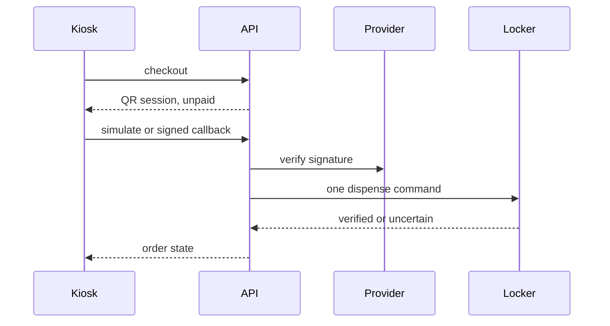

# Commerce

Physical Commerce is an optional self-service mode. It does not replace the television home, and it is not a cash register.

The simulation lives in `packages/commerce`. The API exposes it at `/api/v1/commerce`. The customer screen is `/kiosk`.

A browser message is not proof of payment. The order becomes paid only after `SimulatedQrProvider.verify` accepts a signed notice. The same provider event is applied once.

The simulated locker records the command by order id. A retry after an uncertain result reads that record and does not open the slot again. If the dispenser rejects the command before accepting it, the terminal can retry once or refund.

NFC is reported unavailable. A generic reader is not treated as a card terminal. The simulation stores no card data.

Live acquirers are refused by `assertSimulation`. Orders in this process are in memory and are marked `simulated: true`.
