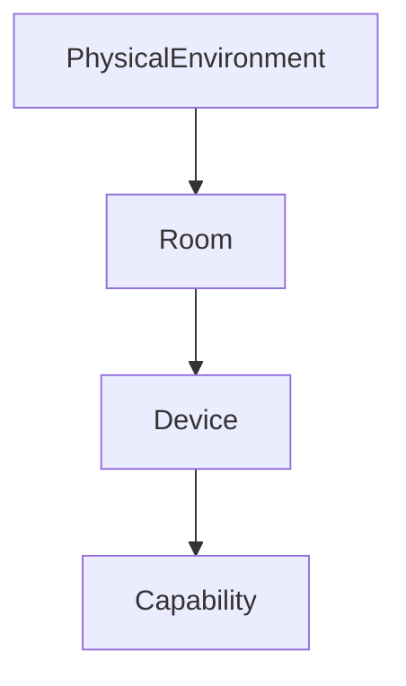

# Device model

A device is not a fixed type. It is an identity plus a set of capabilities.

Observed state is what the adapter last reported. Desired state is what the last authorized command intended. Either can be empty. Unknown connectivity is not treated as online.

Capabilities in the catalog:

| Id | Risk | Writes |
| --- | --- | --- |
| on_off, brightness, media_control | medium | yes |
| temperature_setpoint | high | catalogued, denied by policy |
| temperature_sensor, humidity_sensor, motion_sensor, power_meter, battery, position | low | read only |

`position` is an observation. Moving something is not offered.

Observed values are stored per capability, for example `{ "on_off": { "on": true } }`. Extra fields are rejected by the capability schema.

Metadata is a small map of strings, numbers, booleans and null. `kind` selects lights versus switches when a sentence says “lights”. `simulated` and `isolatedSimulator` mark the simulator. They do not unlock high-risk control unless the process is started with `PHYSICAL_OS_SIM_HIGH_RISK=isolated`, and even then an automation cannot perform that action.
