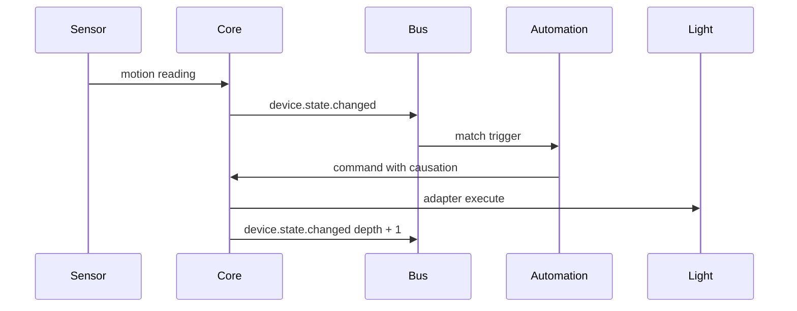

# Event flow

The in-process bus drains events in order. A handler may enqueue another event. It must not wait for the bus to become idle, or the drain deadlocks.

Events include `device.discovered`, `device.connected`, `device.disconnected`, `device.state.changed`, `sensor.reading.received`, `environment.signal.changed`, `automation.triggered`, `automation.failed`, `command.requested`, `command.authorized`, `command.executed` and `command.failed`.

An automation skips an event it caused. Depth stops at 3. Cooldown and `maxRunsPerHour` skip further runs. A dry run records the decision and does not call the adapter.

Time triggers are checked every 15 seconds. That is the resolution of interval and daily rules.
