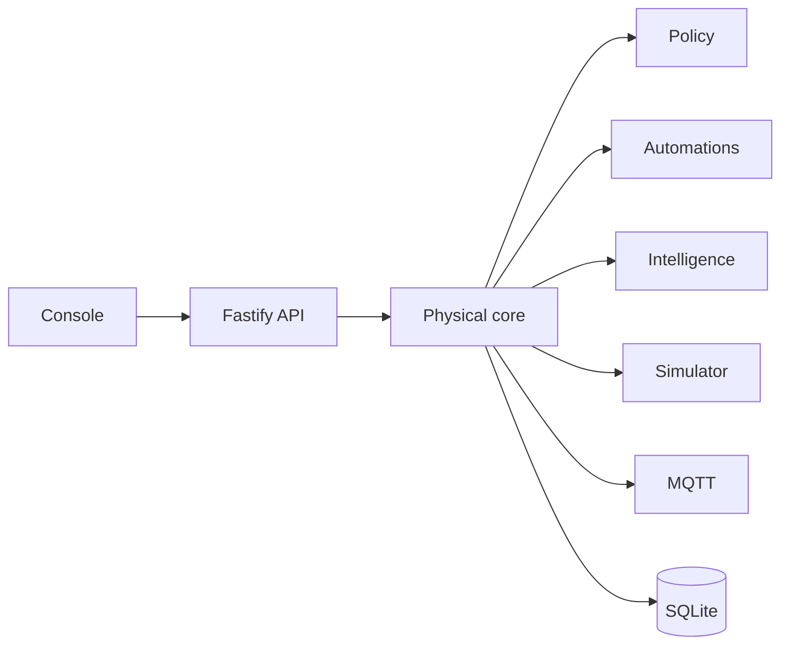

# Architecture

Physical OS is one Node process and one Next.js console. Packages share types. They do not call each other over the network.

The console never imports the core. It calls `/api/v1`. The API checks the session, then calls `PhysicalSystem`.

State in memory is the runtime source. SQLite is a snapshot written after mutations. Restart reloads devices into the simulator and reconnects MQTT when a config was saved.

Command outcomes are `awaiting_approval`, `rejected`, `delivered`, `verified`, `failed`, or `timed_out`. HTTP 200 is used only when `verified` is true. `delivered` means the adapter accepted the command and the following read did not confirm the expected state.

## PostgreSQL

Replace `AppDatabase` with a PostgreSQL Drizzle driver that satisfies the same snapshot and account operations. Do not put SQL in the core. The core depends on `SnapshotStore`.

## Commerce

Self-service checkout is optional. See `docs/architecture/commerce.md`. It uses a simulated QR provider and a simulated locker. It does not replace the television home and it does not take cards.

## Presence

The conversational figure lives in the console at `/presence`. See `docs/architecture/presence.md`. It proposes through the intelligence routes and cannot call an adapter. Camera and microphone stay off until the operator enables them.

## Professional profiles

Installable professions share that presence and the command pipeline. See `docs/architecture/professional-profiles.md`. A profile may propose a plan or open a simulated checkout. It cannot bypass policy, and an update cannot add a permission silently.

## Domains

Home, garden, robot, drone and building products would share the registry, capability model, event bus, automation engine, policy engine, intelligence boundary and audit. Each domain supplies its own capabilities, adapters and policy. None of those products are implemented. `PhysicalEnvironment.domain` is `home` only.
